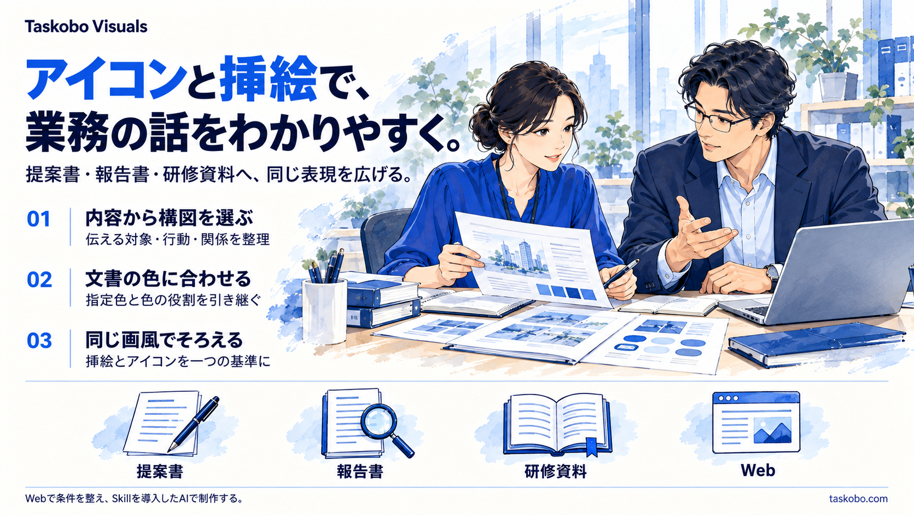

# Taskobo Visuals

Each style applies the exact same drawing method to illustrations and icons under one style ID. Composition and detail adapt to size; contours, fills, materials, texture and lighting do not switch to a related style. One shared registry controls changes and retirement for both asset kinds. Existing examples do not establish pair validation for every style.

Enterprise illustrations and coordinated thematic icons, made with your own AI from a topic or document. Content, art direction and palette remain independent choices.

[日本語](README.md) · [中文](README.zh-CN.md) · [Showcase](https://taskobo.com/free-tools/taskobo-visuals/) · [Request workspace](https://taskobo.com/free-tools/taskobo-visuals/tool/) · [Download v0.6.0](https://github.com/dfzzq719/taskobo-visuals/releases/tag/v0.6.0)



[Explore the three-image story: icons and text → icons, illustration and text → illustration and text](examples/service-story/README.ja.md). These original images were generated using one `enterprise-narrative` drawing method and palette. Original PNGs, prompts and generation records are included. The Web workspace prepares requests; creation takes place in your AI with the Skill installed.

## v0.6.0: 20 shared drawing methods for business documents

Keep 14, retire 10 and add 6: structural duotone, geometric facets, clean handdrawing, workshop marker, colored pencil and editorial gouache. The current total is 20, including enterprise narrative. Icons and illustrations share the exact same drawing definition and lifecycle.

Prefer simple lines and flat forms for regular reports. Select technical, handdrawn or dimensional work for its communication task. Public Chinese, Japanese and US enterprise guidelines inform this editorial selection; it is not a measured adoption ranking. Retired IDs and legacy numbers are never reassigned or silently substituted.

[Current styles, applications and sources](docs/icon-styles.ja.md) · [Actual generation evidence and limits](docs/validation-matrix.ja.md). Per-asset production records, bounded selective retries, independent delivery and approved exact-file reuse remain available in the [workflow guide](docs/production-workflow.ja.md).

## Compare visual directions

Use the [current 20-style guide](docs/icon-styles.ja.md), [Web workspace](https://taskobo.com/free-tools/taskobo-visuals/tool/) and [single registry](references/style-recipes.json). A medium or texture is retained only where it serves a useful business communication task. The [historical 23-style boards](docs/icon-styles-history-v035.ja.md) record earlier experiments and do not describe current selectable styles.

## Start

1. Extract the Skill ZIP from [v0.6.0](https://github.com/dfzzq719/taskobo-visuals/releases/tag/v0.6.0) into a Skill directory supported by your AI application. The folder is `taskobo-visuals`; repository-based installers should use this repository root.
2. Reload the Skill and invoke `$taskobo-visuals` with a topic, use, palette and art direction. The Web workspace creates a reusable request and brief JSON.
3. Review at the intended size and share the approved master, palette and prompts with your team.

```text
Use $taskobo-visuals to make an illustration and six icons for a business handover document.
Use the same enterprise-narrative drawing method for both the illustration and icons.
Use cobalt #1456D9 and navy #0D2046; the target document has a light background.
Generate standalone artwork on genuinely transparent backgrounds, with restrained
semi-transparent shadows if needed. No display platforms or backing plates.
Supply native SVG only for separately constructed editable geometry, plus transparent PNGs.
Save the brief, usage notes and generation prompts.
```

Independent icons and illustrations default to genuine Alpha transparency. Explicit full-scene or comparison-board backgrounds take precedence. [Open the current compact Technical Spot reference](assets/presets/technical-spot-compact.png). v0.3.6 bundles this generation reference and records actual display size, detail level and a style lock. Small icons use one primary object and at most one necessary cue. The older two-view board remains a historical viewpoint study, not the default small-icon anchor.

Standalone artwork defaults to a natural unframed silhouette, with optional peripheral Alpha fading or an explicitly opaque full scene. [Framing](references/image-framing.md) controls composition and background independently of the shared drawing style; it does not add a separate illustration style.

## What runs where

- **Web:** browse samples, recolor their SVG previews, create requests and brief JSON locally in the browser.
- **Your AI with the Skill:** read document evidence, plan imagery and use available image/file/vector tools.
- **Downloads:** four fictional industry packs, each with a raster illustration, six separately authored SVG icons, transparent PNG exports, palette and prompts.

Your AI must supply image generation and any file/vector tools. No model, API key, hosted generation backend, Web document upload or automatic Word/PPT insertion is bundled. Preview color changes do not recolor downloaded packs. Generated pixels and composition vary; approve series masters rather than promising identical output across models.

The Skill's maintained instructions are Chinese; the default public README, usage guide and sample explanations are Japanese. Specify your desired output language.

See [industry samples](docs/gallery.ja.md), [document extraction and usage](docs/guide.ja.md), [development and compatibility](docs/development.ja.md), [the Skill](SKILL.md) and [MIT license](LICENSE). [Taskobo Diagrams](https://github.com/dfzzq719/taskobo-diagrams) covers structured business diagrams.
