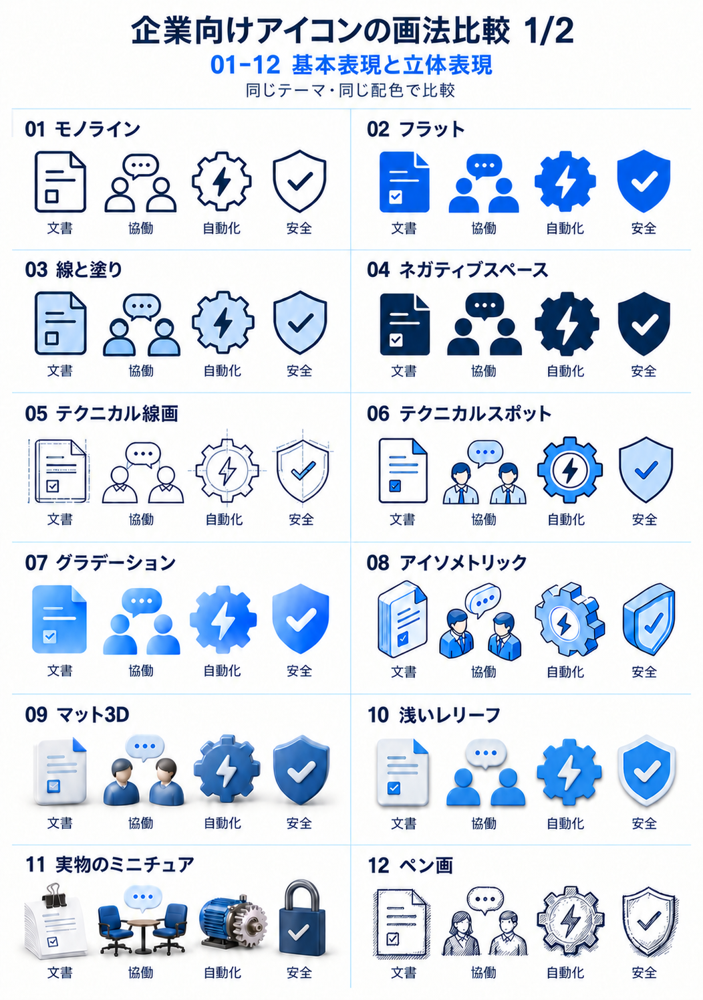
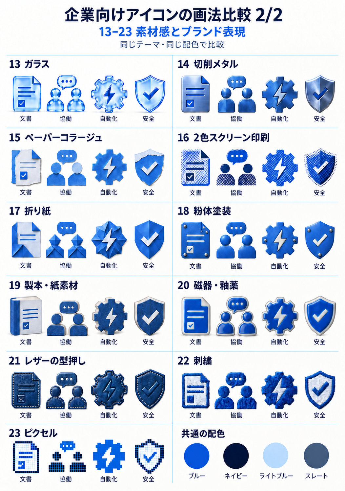

# Taskobo Visuals：企業向けイラスト・アイコンを制作するAIスキル

**業務に合うイラストとアイコンを、チーム共通の基準で。**

テーマや文書から伝える内容を決め、画風と配色を選び、普段使っているAIで制作するAIエージェント用スキル（SKILL.md）。提案書、研修資料、報告書、Webのために、承認した見本と制作条件を引き継ぐ。

[作品を見る](https://taskobo.com/free-tools/taskobo-visuals/) · [制作条件を整える](https://taskobo.com/free-tools/taskobo-visuals/tool/) · [Skillをダウンロード](https://github.com/dfzzq719/taskobo-visuals/releases/tag/v0.5.0) · [利用ガイド](docs/guide.ja.md)

[English](README.en.md) · [中文・维护基准](README.zh-CN.md)

[TaskoboのAIスキル一覧](https://taskobo.com/skills/)で、業務図表の更新と挿絵・アイコン制作の用途を比較できる。

## v0.5.0 — 制作の履歴を残し、採用素材を次の仕事へ

- 素材ごとに実際のプロンプト、参照、生成ツールの返答、出力ファイルを記録する。
- 失敗した素材や修正が必要な素材だけを再制作し、過去の試行と採用済みファイルを残す。
- タスクと独立ファイルを照合。「挿絵1点＋アイコン4点」は5点として確認し、総覧と区別する。
- 採用の根拠を明記した素材を、意味・別名・画法・配色・社内規格の版から探して再利用する。
- 画法の共通定義、会社規格JSON／ZIP、Alpha診断、Webからの引継ぎを継続する。

[制作記録・納品確認・素材の再利用](docs/production-workflow.ja.md) · [会社規格とCLI](docs/enterprise-standard.ja.md) · [画法別の実生成・未検証範囲](docs/validation-matrix.ja.md) · [制作ツール](https://taskobo.com/free-tools/taskobo-visuals/tool/#company-standard)

Webは制作条件を整える。画像はSkillを導入したAIで生成する。機械検査は意味や画風の自動承認ではなく、生成結果の最終採用は実画像を確認して決める。

## 3枚の画像で見る、Skillの使い方

テーマからアイコンをつくり、挿絵へ広げ、チームの共通基準にする。同じ `enterprise-narrative` の画法・配色で、構成の違いを示すオリジナル作例。

### 1. アイコンと文字 — 伝えたい意味を図柄に


### 2. アイコン・挿絵・文字 — 業務資料へ広げる


### 3. 挿絵と文字 — チームの共通基準にする


[3枚の原画像・生成プロンプト・制作記録](examples/service-story/) · [Webで制作条件を整える](https://taskobo.com/free-tools/taskobo-visuals/tool/)

画像として直接生成したプレゼンテーション作例。Webは依頼文と制作条件を作り、画像の制作はSkillを導入したAIで行う。独立素材は透明背景が標準で、この3枚は文字と素材を組み合わせたページ画像。

## 画風を見て選ぶ

線画、フラット、テクニカルスポット、マット3D、ガラス、金属、紙、刺繍まで。2026-10-25にv0.3.5で制作した23の比較作例を、同じ4テーマ・同じブルー系の配色で確認できる。これは制作当時の比較記録であり、現在選べる画風の総数を示すものではない。

<p>
  <a href="docs/icon-styles.ja.md#基本表現と立体表現"></a>
  <a href="docs/icon-styles.ja.md#素材感とブランド表現"></a>
</p>

[23の作例を拡大して見る・用途から選ぶ](docs/icon-styles.ja.md)。2枚とも制作当時のv0.3.5のレシピを使い、06の平面表現と各素材の違いを見直した。番号と名称を依頼文に添えると、求める表現を共有しやすい。配列は用途の広さを考えた目安で、企業の利用率を測定したランキングではない。

現在選べる画風は[制作ツール](https://taskobo.com/free-tools/taskobo-visuals/tool/)と[共通の画法定義](references/style-recipes.json)で確認する。基本方向は選ぶ際の手掛かりで、実行時には具体的な画法ID・名称を使う。今回の文書の意味と配色を組み合わせて依頼文を作る。比較作例は既製アイコン集ではなく、すべての画法や題材を検証済みという意味でもない。[新しい3業務の文書から実際に制作した例](docs/document-driven-validation.ja.md)で、確認した範囲と限界を公開する。

| 基本方向 | 主な用途 | 整理済みのプリセット |
| --- | --- | --- |
| Precision | 説明用アイコン、技術・業務の小さな挿絵 | [`technical-spot`](references/technical-spot.md)：2Dの輪郭線と平面の色面で具体的な対象を伝える |
| Editorial | 人と仕事の関係、書籍、広報の場面イラスト | [`enterprise-narrative`](references/enterprise-narrative.md)：自然な人物と動作、軽い描画の質感 |
| Dimensional | 表紙、製品能力、強調したい概念 | マットな立体と安定した光で方向を決める |

## まず1セット作る

1. [v0.5.0のSkill ZIP](https://github.com/dfzzq719/taskobo-visuals/releases/tag/v0.5.0)を展開し、`taskobo-visuals` フォルダーを利用中のAIソフトのSkill対応ディレクトリに置く。
2. Skillを再読み込みし、制作条件を渡す。[Webの制作ツール](https://taskobo.com/free-tools/taskobo-visuals/tool/)でも依頼文とJSONを作れる。
3. 素材を用途に合うサイズで確認し、採用した見本、配色、生成プロンプトをチームに共有する。

```text
$taskobo-visuals を使い、業務引継ぎ資料の挿絵1点とテーマ別アイコン6点を制作する。
挿絵とアイコンは、同じ enterprise-narrative の画法で制作する。
主色 #1456D9、濃色 #0D2046。配置先は明るい文書。
独立素材は透明PNG。必要な柔らかい影は半透明で残し、展示台は付けない。
図形として制作したアイコンは独立SVGも納品する。
挿絵の計画、使用上の注意、生成プロンプトを日本語で残す。
```

対応AIに画像生成機能が必要。図形を編集できるSVGにはローカルの図形・ファイル操作環境を使う。モデルやAPIキーは同梱しない。Skill手順の原本は中国語で管理しており、日本語の利用ガイド・依頼文・公開ページを用意している。

## 透明背景を標準に

独立したイラストとアイコンは、実際のAlphaチャンネルを持つ透明PNGを標準とする。必要な影は薄い半透明で残し、背景プレートや展示台は加えない。文書の背景色と、生成する素材の透明背景は別々に指定する。

独立素材は自然な輪郭の枠なし構図を標準とし、四角い写真枠に収めない。周辺だけを透明へなじませる構図と、明示した背景付きの全面イラストも選べる。画風は共通のまま、[外形と背景](references/image-framing.md)を指定する。


**作例集では[06 テクニカルスポット](docs/icon-styles.ja.md#06-テクニカルスポット)に対応する。** [現在の透過PNG参照を開く](assets/presets/technical-spot-compact.png)。v0.3.6では生成用の参照画像と、実際の表示サイズに応じた細部の量もSkillに同梱する。72–128px程度の小さな図は、主対象1つと必要な補助1つまでを基本とし、機器や端子を詰め込まない。白い物の表面は残し、周囲を透明にする。明暗両方の背景で輪郭を確認する。[従来の4テーマ見本](docs/assets/icon-styles/technical-spot-transparent.png)は履歴として残す。

[別の文書へ画風を引き継ぐ方法と、題材・配色を変えた実生成](docs/style-portability.ja.md)。

## 文書に合わせ、会社の基準を残す

イラストとアイコンは同じスタイルID・同じ画法で一対一に対応する。線、塗り、材質、質感、光を共通化し、大きさに応じて構図と細部の量だけを調整する。スタイルの追加・変更・廃止は[一つの定義](references/style-recipes.json)で両方へ反映する。既存作例が全スタイルのペア検証済みという意味ではない。

| 項目 | Skillの進め方 |
| --- | --- |
| 内容 | テーマ、対象、行動、読者を整理する。文書があればページや段落の根拠から配図を提案する |
| 画風 | 作例と用途を照合し、視点、線、細部の量をそろえる |
| 配色 | 指定色、文書色、会社の公開済み規定を優先し、色の役割を決める |
| 共有 | 制作ブリーフと承認した見本を版付きで保存し、シリーズの基準として配布する |

管理者は同じSkillと基準を社員へ配布できる。SVGは幾何と色値を固定できる。生成式の画像にはモデルや入力による差があるため、統一するシリーズは承認した見本を参照し、人が採用素材を確認する。

## 業種別の作品例

| 業務 | 見どころ | 作品・元データ |
| --- | --- | --- |
| 製造・物流 | 検品、説明、梱包と引渡し | [Web](https://taskobo.com/free-tools/taskobo-visuals/samples/manufacturing-logistics/) · [素材](examples/manufacturing-logistics/) |
| 小売・サービス | 返品の確認、対話、交換品の準備 | [Web](https://taskobo.com/free-tools/taskobo-visuals/samples/retail-service/) · [素材](examples/retail-service/) |
| 医療・ケア | 相談、記録の共有、支援の引継ぎ | [Web](https://taskobo.com/free-tools/taskobo-visuals/samples/healthcare-care/) · [素材](examples/healthcare-care/) |
| 教育・研修 | 手を動かす、考える、振り返る | [Web](https://taskobo.com/free-tools/taskobo-visuals/samples/education-training/) · [素材](examples/education-training/) |

各業種に挿絵1点、図形を編集できるSVGアイコン6点、透明PNG、元の配色、依頼文と生成プロンプトがある。架空の業務場面から制作したオリジナル作品。利用者が提供した参考画像や顧客文書は含めない。

## 実行場所と出力

| 使う場所 | できること |
| --- | --- |
| Web制作ツール | テーマ、用途、画風、配色を選び、依頼文と制作ブリーフJSONをブラウザー内で作る |
| Skillを導入したAI | 文書の根拠を読み、挿絵を計画し、そのAIの機能で画像や図形を制作する |
| ダウンロード素材 | 独立SVG、透明PNG、作品例とプロンプトを手元で再利用する |

Webページ上の画像生成、文書アップロード、Word/PPTへの自動配置は提供していない。Webの配色プレビューはサンプルのSVGに適用し、既存ダウンロードの色は変更しない。生成したビットマップをSVGに包んでも、図形を編集できるベクター素材にはならない。

## 詳しい資料

[日本語の利用ガイド](docs/guide.ja.md) · [画風と素材の作例集](docs/icon-styles.ja.md) · [業種別ギャラリー](docs/gallery.ja.md) · [開発・互換性](docs/development.ja.md) · [Skill本体](SKILL.md)

構造化した業務図表は [Taskobo Diagrams](https://github.com/dfzzq719/taskobo-diagrams)、挿絵とテーマ別アイコンの表現は Taskobo Visuals が担当する。

[MIT License](LICENSE)。公開済みの固定アーカイブは保持する。生成素材の業務内容、権利、実際の表示品質は用途に応じて確認する。
