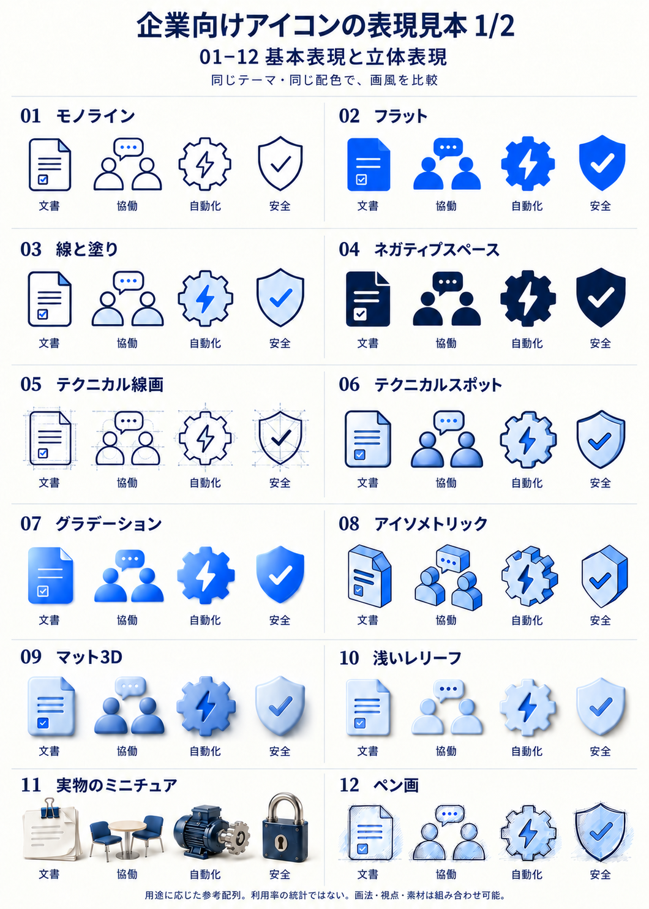
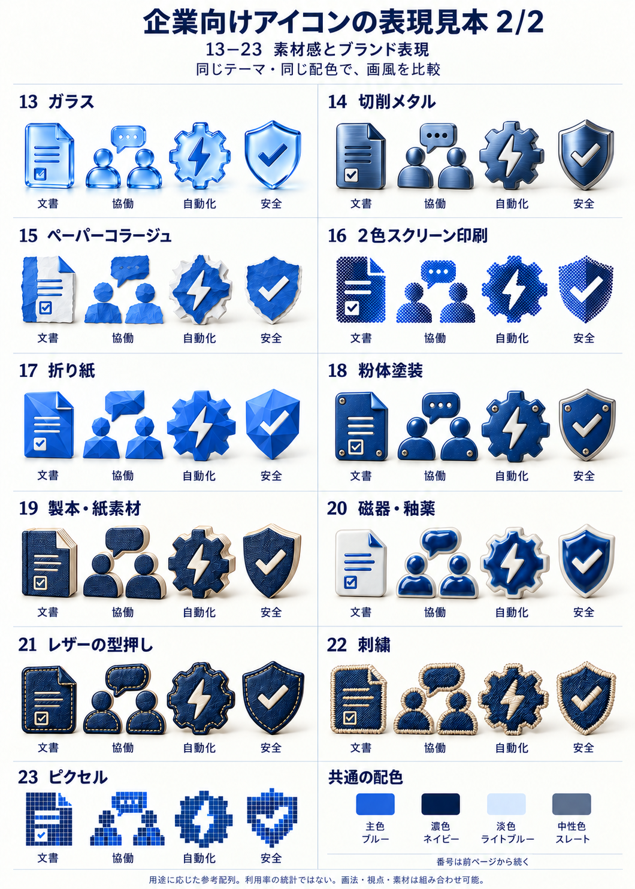

# Taskobo Visuals

**業務に合うイラストとアイコンを、チーム共通の基準で。**

テーマや文書から伝える内容を決め、画風と配色を選び、普段使っているAIで制作するSkill。提案書、研修資料、報告書、Webのために、承認した見本と制作条件を引き継ぐ。

[作品を見る](https://taskobo.com/free-tools/taskobo-visuals/) · [制作条件を整える](https://taskobo.com/free-tools/taskobo-visuals/tool/) · [Skillをダウンロード](https://github.com/dfzzq719/taskobo-visuals/releases/tag/v0.3.3) · [利用ガイド](docs/guide.ja.md)

[English](README.en.md) · [中文・维护基准](README.zh-CN.md)


## 画風を見て選ぶ

線画、フラット、テクニカルスポット、マット3D、ガラス、金属、紙、刺繍まで。23の作例を、同じ4テーマ・同じブルー系の配色で比較できる。

<p>
  <a href="docs/icon-styles.ja.md#基本表現と立体表現"></a>
  <a href="docs/icon-styles.ja.md#素材感とブランド表現"></a>
</p>

[23の作例を拡大して見る・用途から選ぶ](docs/icon-styles.ja.md)。番号と名称を依頼文に添えると、求める表現を共有しやすい。配列は用途の広さを考えた目安で、企業の利用率を測定したランキングではない。

現在のSkillは3つの基本方向と2つの具体的なプリセットを持つ。作例集は画法・視点・素材の選択肢を示すもので、23種類すべてを固定パラメーターのプリセットとして配布するものではない。

| 基本方向 | 主な用途 | 整理済みのプリセット |
| --- | --- | --- |
| Precision | 説明用アイコン、技術・業務の小さな挿絵 | [`technical-spot`](references/technical-spot.md)：輪郭と控えめな明暗で具体的な対象を伝える |
| Editorial | 人と仕事の関係、書籍、広報の場面イラスト | [`enterprise-narrative`](references/enterprise-narrative.md)：自然な人物と動作、軽い描画の質感 |
| Dimensional | 表紙、製品能力、強調したい概念 | マットな立体と安定した光で方向を決める |

## まず1セット作る

1. [v0.3.3のSkill ZIP](https://github.com/dfzzq719/taskobo-visuals/releases/tag/v0.3.3)を展開し、`taskobo-visuals` フォルダーを利用中のAIソフトのSkill対応ディレクトリに置く。
2. Skillを再読み込みし、制作条件を渡す。[Webの制作ツール](https://taskobo.com/free-tools/taskobo-visuals/tool/)でも依頼文とJSONを作れる。
3. 素材を用途に合うサイズで確認し、採用した見本、配色、生成プロンプトをチームに共有する。

```text
$taskobo-visuals を使い、業務引継ぎ資料の挿絵1点とテーマ別アイコン6点を制作する。
挿絵は enterprise-narrative、アイコンは technical-spot を使う。
主色 #1456D9、濃色 #0D2046。配置先は明るい文書。
独立素材は透明PNG。必要な柔らかい影は半透明で残し、展示台は付けない。
図形として制作したアイコンは独立SVGも納品する。
挿絵の計画、使用上の注意、生成プロンプトを日本語で残す。
```

対応AIに画像生成機能が必要。図形を編集できるSVGにはローカルの図形・ファイル操作環境を使う。モデルやAPIキーは同梱しない。Skill手順の原本は中国語で管理しており、日本語の利用ガイド・依頼文・公開ページを用意している。

## 透明背景を標準に

独立したイラストとアイコンは、実際のAlphaチャンネルを持つ透明PNGを標準とする。必要な影は薄い半透明で残し、背景プレートや展示台は加えない。文書の背景色と、生成する素材の透明背景は別々に指定する。


**作例集では[06 テクニカルスポット](docs/icon-styles.ja.md#06-テクニカルスポット)に対応する。** [この透過PNGを開く](docs/assets/icon-styles/technical-spot-transparent.png)。上は4テーマを一枚に配置した表示用の見本で、白い部分を含む物の表面は残し、周囲を透明にしている。明暗両方の背景で輪郭を確認する。完全な場面背景や色付きの比較表を明示した場合は、その指定に従う。

## 文書に合わせ、会社の基準を残す

| 項目 | Skillの進め方 |
| --- | --- |
| 内容 | テーマ、対象、行動、読者を整理する。文書があればページや段落の根拠から配図を提案する |
| 画風 | 作例と用途を照合し、視点、線、細部の量をそろえる |
| 配色 | 指定色、文書色、会社の公開済み規定を優先し、色の役割を決める |
| 共有 | 制作ブリーフと承認した見本を版付きで保存し、シリーズの基準として配布する |

管理者は同じSkillと基準を社員へ配布できる。SVGは幾何と色値を固定できる。生成式の画像にはモデルや入力による差があるため、統一するシリーズは承認した見本を参照し、人が採用素材を確認する。

## 業種別の作品例

| 業務 | 見どころ | 作品・元データ |
| --- | --- | --- |
| 製造・物流 | 検品、説明、梱包と引渡し | [Web](https://taskobo.com/free-tools/taskobo-visuals/samples/manufacturing-logistics/) · [素材](examples/manufacturing-logistics/) |
| 小売・サービス | 返品の確認、対話、交換品の準備 | [Web](https://taskobo.com/free-tools/taskobo-visuals/samples/retail-service/) · [素材](examples/retail-service/) |
| 医療・ケア | 相談、記録の共有、支援の引継ぎ | [Web](https://taskobo.com/free-tools/taskobo-visuals/samples/healthcare-care/) · [素材](examples/healthcare-care/) |
| 教育・研修 | 手を動かす、考える、振り返る | [Web](https://taskobo.com/free-tools/taskobo-visuals/samples/education-training/) · [素材](examples/education-training/) |

各業種に挿絵1点、図形を編集できるSVGアイコン6点、透明PNG、元の配色、依頼文と生成プロンプトがある。架空の業務場面から制作したオリジナル作品。利用者が提供した参考画像や顧客文書は含めない。

## 実行場所と出力

| 使う場所 | できること |
| --- | --- |
| Web制作ツール | テーマ、用途、画風、配色を選び、依頼文と制作ブリーフJSONをブラウザー内で作る |
| Skillを導入したAI | 文書の根拠を読み、挿絵を計画し、そのAIの機能で画像や図形を制作する |
| ダウンロード素材 | 独立SVG、透明PNG、作品例とプロンプトを手元で再利用する |

Webページ上の画像生成、文書アップロード、Word/PPTへの自動配置は提供していない。Webの配色プレビューはサンプルのSVGに適用し、既存ダウンロードの色は変更しない。生成したビットマップをSVGに包んでも、図形を編集できるベクター素材にはならない。

## 詳しい資料

[日本語の利用ガイド](docs/guide.ja.md) · [画風と素材の作例集](docs/icon-styles.ja.md) · [業種別ギャラリー](docs/gallery.ja.md) · [開発・互換性](docs/development.ja.md) · [Skill本体](SKILL.md)

構造化した業務図表は [Taskobo Diagrams](https://github.com/dfzzq719/taskobo-diagrams)、挿絵とテーマ別アイコンの表現は Taskobo Visuals が担当する。

[MIT License](LICENSE)。公開済みの固定アーカイブは保持する。生成素材の業務内容、権利、実際の表示品質は用途に応じて確認する。
