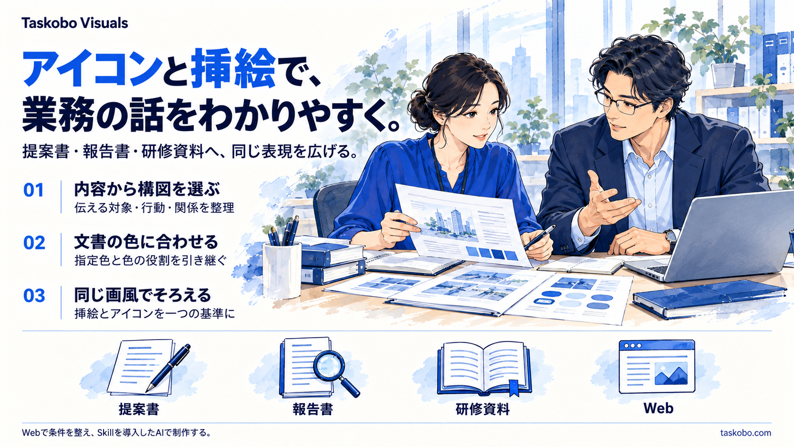

# Taskobo Visuals

插图与图标完全共用同一个样式ID和画法，一一对应；只按尺寸调整构图与细节量。轮廓、填色、材质、纹理和光照不另行选择。样式新增、修改、停用与删除统一维护[一份目录](references/style-recipes.json)，同时影响两类资产；已有示例不等于所有样式的配套成图均已验证。

**围绕业务内容制作企业插图与主题图标，让团队沿用共同的视觉基准。**

中文作为内容维护基准，默认公开入口为[日文首页](README.md)，另有[英文简介](README.en.md)。Skill当前固定发行版为[v0.6.0](https://github.com/dfzzq719/taskobo-visuals/releases/tag/v0.6.0)。

[作品展示](https://taskobo.com/free-tools/taskobo-visuals/) · [制作条件与依頼文工具](https://taskobo.com/free-tools/taskobo-visuals/tool/) · [当前20种共用画法](docs/icon-styles.ja.md)

## v0.6.0：面向企业资料的20种画法

保留14种、停用10种、增加6种，当前20种包含企业叙事。退出刺绣、皮革、瓷釉等材质实验；加入结构双色、几何多面、清爽手绘、商务马克笔、彩铅、不透明水粉。图标和插图的画法、版本与停用始终同步。

普通报告优先选择清楚的线稿与平面，技术、手绘及立体按用途选择。目录基于中日美公开规范与适用性判断，不是市场使用率榜单。旧ID、旧编号不复用，停用规范明确报告差异，不自动更换风格。

[筛选依据和20种用途](references/enterprise-style-curation.md) · [日文公开目录](docs/icon-styles.ja.md) · [实际验证范围](references/validation-matrix.md)

保留v0.5的逐张制作、有限重试、独立文件交付和认可素材复用能力。图片由安装Skill的宿主AI制作，文件验收不代表语义或审美自动通过。

## 三张图片展示同一套Skill的能力

[查看完整三图故事与生成记录](examples/service-story/README.ja.md)：图标与文字 → 图标、插图与文字 → 插图与文字。三张统一使用 `enterprise-narrative` 画法与蓝色系，展示从业务语义到团队共通视觉标准的过程。保留原图与实际生成提示词；Web整理制作条件，安装Skill的AI执行生成。

## 内容、风格与色系分别选择

- 内容来自本次业务主题、受众和文档依据，不把任何单一行业当作默认。
- 画法、视角与材质按用途组合，系列内统一线条、视觉重量和细节量。
- 配色优先使用用户、公司或文档中的明确规范，主题色和状态色分别处理。
- 企业可分发同一Skill、制作简报与已认可的母样；生成图仍需逐图审核。

当前20种使用[唯一共享目录](references/style-recipes.json)。手绘、平面与立体均有明确的适用范围，图标与插图不单独维护。历史23种对照图仅保留在[旧版记录](docs/icon-styles-history-v035.ja.md)，不能作为当前可选项列表。

## 独立素材默认透明背景

独立图标和配图默认交付带真实Alpha的透明PNG，必要的柔和阴影保留为渐隐半透明，无装饰展示底座。文档底色与素材画布分开；用户明确指定完整场景或带底色对照图时按该要求执行。

独立素材默认采用自然外轮廓的无外框构图，不把所有画面装进方形或矩形相框。可选外围渐隐到透明，或明确需要时使用完整背景场景；这些是[外形参数](references/image-framing.md)，与统一画法组合，不另建一套样式。

[当前紧凑画法透明参考](assets/presets/technical-spot-compact.png)已实际检查Alpha，并随v0.3.6安装包分发。生成时实际传入该参考，记录版本、画法、参考哈希、显示尺寸、细节等级和色板。72–128px小图标默认一个主对象＋至多一个必要提示，不堆设备、端口和电路细节。旧四主题透明样稿和双视角白底样稿保留作历史，不再作为小图标的默认密度依据。生成位图不自动成为可编辑SVG，需要原生图形的图标另用矢量工具制作。

## 使用与交付

1. 下载并安装 `taskobo-visuals`，在支持Skill的AI中重新载入。
2. 指定主题、用途、配色、画风和输出语言；可先在网站生成依頼文与简报JSON。
3. 用AI中可用的图像、文件和图形工具制作，按实际尺寸审核，保存认可母样、提示词和版本。

网站负责展示、SVG配色预览与依頼文/JSON创建；图片生成和文档读取由安装Skill的AI执行。网站尚不提供生图后端、文档上传或Word/PPT自动回写。已有下载包的颜色不会随网页预览改变。

四个虚构行业样例覆盖制造物流、零售服务、医疗照护、教育培训，每套提供主插图、6个原生SVG及透明PNG、原始配色与生成提示词。所有公开样例为原创示意，不代表客户部署或经过验证的工作流程；用户原始截图和客户文档不纳入公开素材。

模型与输入会影响生成结果，不承诺所有像素或不同模型的输出完全一致。采用固定几何和色值的SVG、版本化规范及已认可母样来建立可复用的企业基准。

[使用指南](docs/guide.ja.md) · [行业样例](docs/gallery.ja.md) · [维护与兼容性](docs/development.ja.md) · [Skill源文件](SKILL.md) · [MIT许可](LICENSE)
