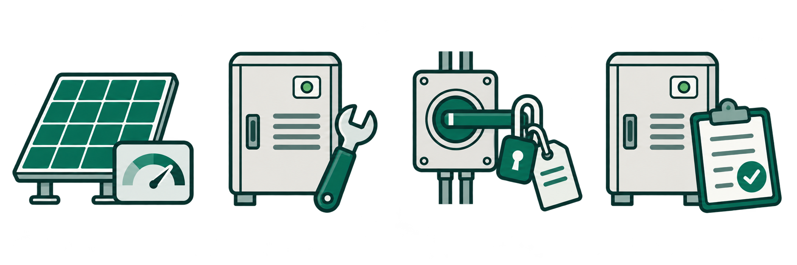

# 文書から新しいアイコンを制作した検証

[README](../README.md) · [画法の作例](icon-styles.ja.md) · [利用ガイド](guide.ja.md)

2026-10-25、Skill v0.3.5の文書抽出、Agentによる意味の整理、画法レシピの適用、内蔵imagegenでの実生成を確認した。見本の対象やブルー系の配色を固定せず、3種類の新しい架空業務から各4点を制作した。顧客文書や利用者の参考画像は含めない。

## 実際に生成した3セット

### 保険金請求の確認 — DOCX

事故受付、証憑照合、追加確認、支払承認。追加確認は保留を表し、承認済みへ置き換えない。配色は資料に指定したプラム系。


[元DOCX](examples/document-driven/insurance/claims-review.docx) · [抽出した証拠](examples/document-driven/insurance/context.json) · [意味と対象を整理したブリーフ](examples/document-driven/insurance/brief.json) · [実際の生成指示](examples/document-driven/insurance/actual-imagegen.prompt.txt) · [記録・Alpha検査](examples/document-driven/insurance/generation-record.json)

### 太陽光設備の保全 — PPTX

発電監視、設備点検、作業許可、復旧確認。非数値の概念図であり、配線図、安全手順書、性能実績を表さない。配色は資料に指定したティール系。



[元PPTX](examples/document-driven/energy/solar-maintenance.pptx) · [抽出した証拠](examples/document-driven/energy/context.json) · [意味と対象を整理したブリーフ](examples/document-driven/energy/brief.json) · [実際の生成指示](examples/document-driven/energy/actual-imagegen.prompt.txt) · [記録・Alpha検査](examples/document-driven/energy/generation-record.json)

### 入社と権限の準備 — Markdown

入社準備、権限申請、研修受講、試用面談。アクセス権の申請は承認待ちを表し、付与済みのチェックを加えない。配色は資料に指定したアンバー系。


[元Markdown](examples/document-driven/people/employee-onboarding.md) · [抽出した証拠](examples/document-driven/people/context.json) · [意味と対象を整理したブリーフ](examples/document-driven/people/brief.json) · [実際の生成指示](examples/document-driven/people/actual-imagegen.prompt.txt) · [記録・Alpha検査](examples/document-driven/people/generation-record.json)

## 何を確認し、何が未確認か

| 段階 | 今回の確認 | 残る限界 |
| --- | --- | --- |
| 文書を読む | DOCXの段落、PPTXの実際のスライド順、Markdownの行を抽出。入力ファイルのハッシュは処理前後で一致 | スキャンOCRや複雑なレイアウトは今回未検証 |
| 意味を整理する | Agentが原文→意味→物・動作→避ける誤解を12項目で記録 | 作成Agent自身の判断。独立した読者による評価ではない |
| 画法を適用する | 23レシピすべてで番号・ID・中日英名称が対応し、同じ新テーマと配色を保つことを検査 | 23レシピすべての画像を生成・採点したものではない |
| 実際に描く | 06 `technical-spot` で3セット、計12点を透明PNGの一覧として生成 | 独立した12ファイルや図形を編集できるSVGを納品したという意味ではない |
| 画像を見る | 主な物、順番、保留状態、2Dの線と塗り、指定色系、実際のAlphaを確認 | 少量の色調差は残る。正確なHEX、厳密な小物構造、任意文書の一回成功は保証しない |

すべて採用前の草稿。図形は意味を見分ける補助であり、承認の順序、役割、条件や作業手順は編集可能な本文に残す。画像モデルはSkill本体に含まれず、宿主AIの生成機能を使う。

## 同じ進め方を新しい文書に適用する

```text
$taskobo-visuals を使い、添付文書から必要な説明用アイコンを制作する。
06 technical-spot、2Dの輪郭と塗り、台座なし、透明PNG。
テーマと描く対象は今回の文書から決める。見本の対象はコピーしない。
各素材の根拠、意味、物・動作、避ける誤解を整理する。
配色は当社の指定色を優先し、なければ文書から根拠を示して提案する。
実際に生成して確認し、原図、ブリーフ、プロンプトと検査記録を残す。
```

Skillはこの判断と制作の手順を提供する。`extract_context.py` は読み取り、`prepare_icon_jobs.py` は整理済みのブリーフとレシピの組合せを担当する。どちらも独自の画像生成モデルや文書理解モデルではない。
