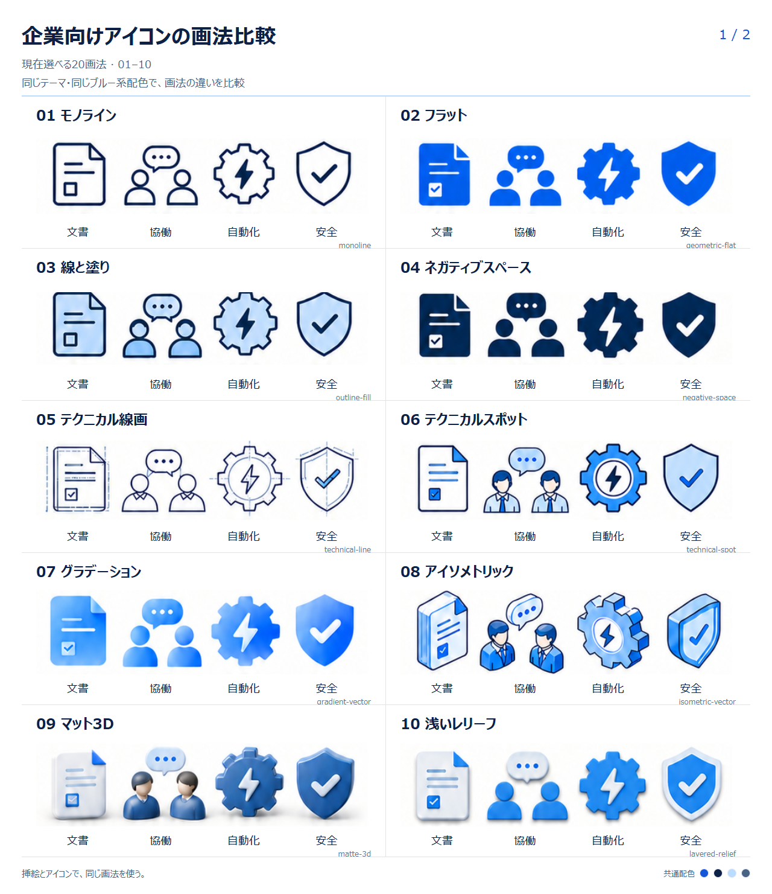
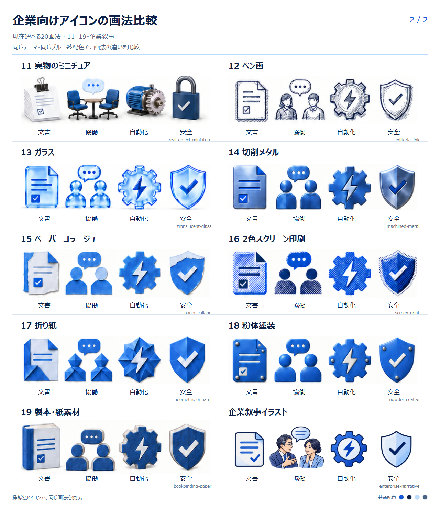

# アイコンの画法・素材 作例集

[公開README](../README.md) · [利用ガイド](guide.ja.md) · [制作ツール](https://taskobo.com/free-tools/taskobo-visuals/tool/)

文書、協働、自動化、安全の4テーマを、同じブルー／ネイビー系で比較する。画法、視点、素材は組み合わせられる。番号は会話の中で参照するための目印であり、企業の実測利用率や品質の順位ではない。

クラウド、物流、医療、学習の原作例は **[06 テクニカルスポット](#06-テクニカルスポット)**。比較表の06は、同じ画法で文書・協働・自動化・安全を描き直している。原作例の対象をそのまま比較表へ移したものではない。

現在選べるのは、番号01–19と「企業叙事イラスト」の合計20種。挿絵とアイコンは[共通の画法定義](../references/style-recipes.json)を使う。企業叙事は未番号の既存プリセットで、IDは `enterprise-narrative`。旧番号20–23は選択肢から外し、既存の番号は変えていない。

以下は2026-11-06に整理した現在の20種比較。01–19は2026-10-25の原画を描き直さず、表示範囲と配置だけを整えた。企業叙事のみ、同じ4テーマの図柄を内蔵imagegenで追加した。見出しとラベルはMeiryo UIで組版した。[配置と原図の記録](assets/icon-styles/current/presentation.json)・[HTML原稿](assets/icon-styles/current/gallery.html)・[企業叙事の生成プロンプト](assets/icon-styles/current/enterprise-narrative.prompt.txt)を公開する。

比較は画法を選ぶための見本であり、既製アイコン集や全題材の検証結果ではない。[文書から実際に制作した検証例](document-driven-validation.ja.md)は別に記録する。

## 01–10 基本表現と立体表現



## 11–19・企業叙事 素材感と手描き表現



## 用途から絞る

| 番号 | 表現 | 見分ける特徴 | 用途の手掛かり |
| --- | --- | --- | --- |
| 01 | モノライン | 均一な線、塗りなし | 案内、操作の補助、簡潔な資料 |
| 02 | フラット | 輪郭線を省いた幾何形 | 機能の一覧、社内文書、Web |
| 03 | 線と塗り | 濃い輪郭と少量の色面 | 業務の説明、研修、提案書 |
| 04 | ネガティブスペース | 抜きの形で意味を作る | 強いシルエット、単色印刷 |
| 05 | テクニカル線画 | 外形と内部の線を分ける | 技術の概念、構造の説明 |
| 06 | [テクニカルスポット](#06-テクニカルスポット) | 2Dの輪郭と平面の色面、細い構造線 | 具体的な物やサービスの説明 |
| 07 | グラデーション | 平面の中の滑らかな色変化 | デジタル製品や能力の紹介 |
| 08 | アイソメトリック | 一定の角度と浅い側面 | 構成、仕組み、サービスの関係 |
| 09 | マット3D | 丸みのある立体、控えめな反射 | 表紙、機能の見出し、強調箇所 |
| 10 | 浅いレリーフ | 薄い層と近い影 | 階層や層のある概念 |
| 11 | 実物のミニチュア | 紙、椅子、モーター、錠の実物感 | 現実の対象を手掛かりにする説明 |
| 12 | ペン画 | 線の強弱と軽いハッチング | 書籍、編集、親しみのある解説 |
| 13 | ガラス | 透過、屈折、明確な縁 | デジタルな軽さを示す主題表現 |
| 14 | 切削メタル | 切削の面と細い金属の筋 | 精度や工業の質感を示す主題 |
| 15 | ペーパーコラージュ | 薄い紙の重なりと繊維 | 編集、サステナビリティの表現 |
| 16 | 2色スクリーン印刷 | 網点と2色の版のずれ | 紙面、広報、印刷の質感 |
| 17 | 折り紙 | 折り目と角のある面 | 構成や組立てを示す主題 |
| 18 | 粉体塗装 | 細かな塗装肌と硬い殻 | 設備や工業品質の主題 |
| 19 | 製本・紙素材 | 紙の層、布、製本の接合 | 学習、知識、出版の主題 |
| 名称指定 | 企業叙事イラスト | 強弱のある墨線、自然な人物、薄い水彩の質感 | 提案、業務場面、広報、書籍の挿絵 |

小さな操作アイコンには線や単純な形を使い、素材感を見せる絵は十分な表示サイズを確保する。選んだ表現を一つのシリーズでそろえ、単に色を変えて意味を区別しない。

## 06 テクニカルスポット

小さな業務図では、v0.3.6同梱の[現在のコンパクト参照](../assets/presets/technical-spot-compact.png)を使う。主対象と必要な補助に絞り、現在の参照を生成ツールへ渡す。[別文書への引継ぎ検証](style-portability.ja.md)を参照。以下の4テーマは従来の画法作例として保ち、小さな図に細部を詰め込む指示としては使わない。

**この4点の画法がNo.06（`technical-spot`）。** 比較表では題材を他の作例とそろえている。03より線の強弱や構造の描写を加えた平面の説明イラスト。人頭は平面の円、衣服は平面の色面として描き、球面の陰影やプラスチックの立体感は加えない。08のアイソメトリックは投影视点の例であり、06を3Dにするという意味ではない。


独立素材は透明背景を標準にする。上のPNGは実際のAlphaチャンネルを持ち、周囲が透明で、物の白い面は残している。元の2視点の比較画像は[プリセット参考](../assets/presets/technical-spot.png)に保管する。

比較表の白い面は見本を読むための表示背景。生成する単独素材には引き継がない。柔らかい影は半透明で薄く残せる。明暗両方の背景で、縁の色や切れ、物の識別を確認する。

## 依頼するとき

```text
$taskobo-visuals を使う。作例06「テクニカルスポット」の画法で、
今回の業務テーマから説明用アイコンを作る。配色は添付の会社規定に合わせる。
視点は正面、背景は透明、展示台は付けない。
対象と構図はこの作例を写さず、今回伝えたい仕事から決める。
```

他の番号を選ぶ場合は、番号と名称に加えて対象・用途・表示サイズを指定する。固定パラメーターで同じ画素が再現されるという意味ではない。

## 旧23種の比較記録

以下は2026-10-25にv0.3.5の23レシピから制作した原図。20「磁器・釉薬」、21「レザーの型押し」、22「刺繍」、23「ピクセル」を含むため、現在の選択ガイドには使わない。原画像と当時の記録は変更せず残す。

[旧比較画像1：01–12](assets/icon-styles/styles-ja-01-v4.png) · [旧比較画像2：13–23](assets/icon-styles/styles-ja-02-v2.png) · [当時の生成・修正プロンプト](assets/icon-styles/regeneration-20261025.prompts.json)

06は平面の輪郭と色面、07は平面内のグラデーション、09は丸みのある立体、10は薄い層の重なりとして描き分けた。11は同じ4概念を実物の比喩で表す。比較画像を制作したことと、任意の文書で全画法を検証したことは区別する。

## 元データと公開範囲

[中文の維持基準と名称一覧](assets/icon-styles/catalog.json) · [中文原図1](assets/icon-styles/source-zh-01.png) · [中文原図2](assets/icon-styles/source-zh-02.png) · [生成元](assets/icon-styles/provenance.json)

画像は内蔵imagegenによるオリジナルの表示用作例。元の作成プロンプト、日文への差替えプロンプト、透過版の編集プロンプトを同じ素材フォルダーに保存する。利用者の私有参考画像は含めない。配布済みの固定アーカイブは変更しない。
