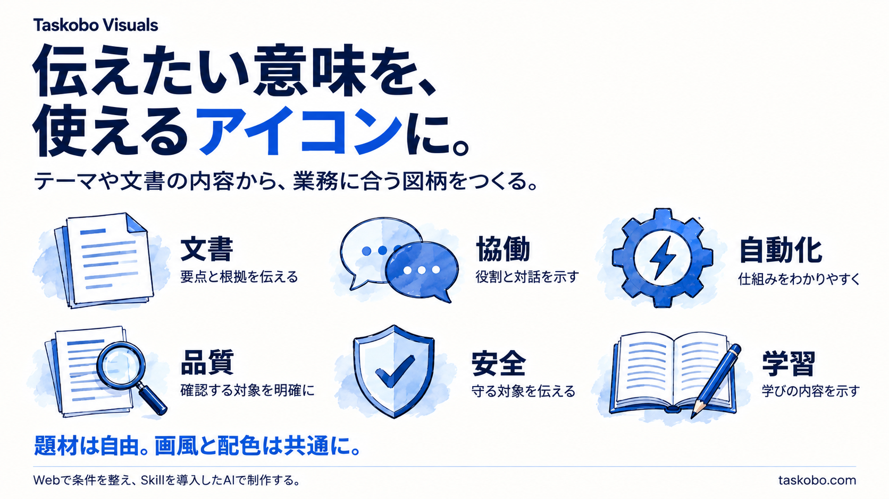
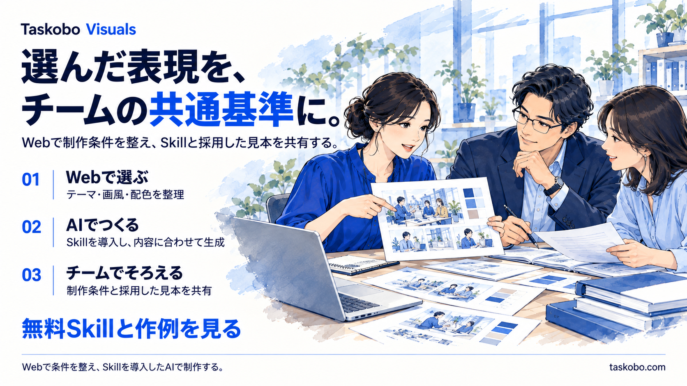

# Taskobo Visualsを3枚の画像で紹介

WebとSkillの使い方を、異なる構成のプレゼンテーション画像で伝えるオリジナル作例。3枚とも `enterprise-narrative` の墨線・色面・軽い水彩の画法とブルー系の配色を使う。PPTXではなく、画像として直接生成した。

## 1　アイコンと文字

テーマや文書の意味から、業務に合うアイコンを制作する。

## 2　アイコン・挿絵・文字

同じ表現を、提案書・報告書・研修資料へ広げる。

## 3　挿絵と文字

Webで制作条件を整え、Skillを導入したAIで制作し、条件と採用した見本をチームに共有する。

[Web制作ツール](https://taskobo.com/free-tools/taskobo-visuals/tool/) · [Skill](../../SKILL.md) · [生成記録](provenance.json)

内蔵imagegenで直接制作し、公開用に承認されたオリジナル作例。各ページの実際の生成プロンプトは同じフォルダーの `page-01.prompt.txt` ～ `page-03.prompt.txt` に保存している。独立した素材は透明背景を標準とするが、この作例は文字と素材を組み合わせたページ全体のため、不透明な背景を持つ。Web上での画像生成や文書アップロードを提供しているという意味ではない。
