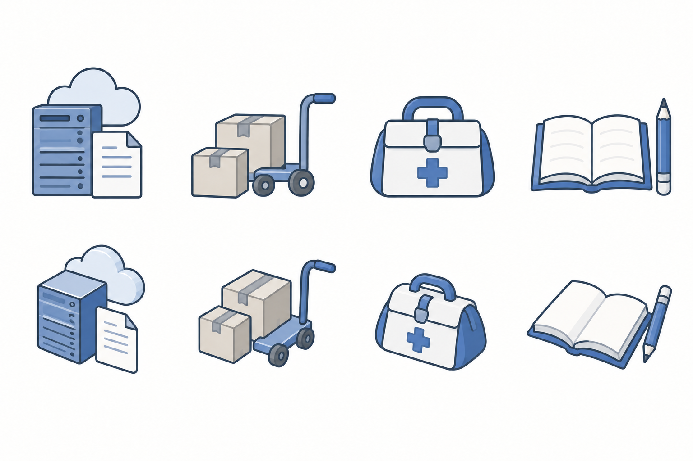

# 技术主题小插图 / Technical Spot Illustration

标识：`technical-spot`。基础方向：`precision`。用户于2026-10-25要求保留参考中的画法，状态为 `accepted-option`。新生成样稿仍为 `draft`，不能视为用户逐张认可的母样。



[机器可读预设](../assets/presets/technical-spot.json)。公开样稿采用云服务、物流、医疗、学习四个主题；上行平视、下行浅轴测，两行均无底座。它用于说明视角变化，不是每次必须沿用的布局或对象。用户原始参考仅作私有画法参考，不纳入公开包。

独立输出默认透明背景，平视和浅轴测相同。当前样稿的白色底只用于展示画法；复用时不继承该底色。需要的柔和阴影保留为半透明，不增加展示底座。内置 imagegen 使用 `transparent_background: true`，交付前检查真实 Alpha 和深浅底上的边缘。

## 识别特征与适用范围

- **分级轮廓**：示例用深蓝灰外轮廓，内部结构线更细、更轻。曲线和接合流畅，稍有插画亲和感，但不画成抖动草线。
- **克制色面**：主题色与浅灰、中性面交代对象，以少量轻明暗区分体积；不依赖强渐变、玻璃高光或照片纹理。
- **具体而简化的物件**：比例、接合和重叠可信，保留用于识别用途的结构。细节介于符号和完整业务场景之间，通常围绕一个对象或一个小关系。
- **清楚的说明性气质**：适合企业PPT、报告、培训资料中的能力、设备、服务和业务动作。它不是工程结构图或精确操作证明。

基础 `precision` 强调简洁符号与描边填色；本预设可保留更多物件结构和轻微插画感。`enterprise-narrative` 更适合人物、业务动作与环境构成的完整情境，并使用轻绘画质感。三个选择可以在同一报告中分工，不把各自的细节密度混进同一组图标。

## 视角与配色独立选择

| 维度 | 可选值 | 选择依据 |
|---|---|---|
| 视角 `viewpoint` | `front`、`side`、`three-quarter`、`shallow-isometric` | 让本次对象最易辨认的面；不要把侧视图也称为等距图。 |
| 底座 `base` | `none` | 本预设不加装饰展示台、方形承托或底板，浅轴测也不例外。 |
| 配色 | 用户色、公司色、文档色或推荐色板 | 深色轮廓、主色、浅色面、中性面的角色保持清楚。蓝灰只是示范，不是固定品牌色。 |

同一交付系列统一主要视角、轮廓层级和细节密度。比较视角时可像样稿一样分行标示；普通业务系列不无理由混用。物件自身具有语义的结构仍按内容保留，不额外铺设承托整个图标的装饰底板。用户以后明确要求重新设计时，以新要求为准。

题材来自当次任务。车辆、卫星、地球和机械臂只是用户参考中的内容，不成为本预设的默认对象；同样适用于金融、零售、物流、医疗、教育、能源及专业服务。

## 复用方式

```json
{
  "direction": {"id": "precision", "preset": "technical-spot", "origin": "user", "status": "draft"},
  "layout": {"viewpoint": "front", "base": "none"}
}
```

使用图像工具前查看样稿，把它作为画法参考。当前对象、业务动作、视角与色板分别写入提示词，并写明不加展示底座；不把样稿当成必须保留对象的编辑目标。

```text
Create a technical spot illustration of [current object and business action].
Use graded dark contours, finer lighter structural lines, restrained flat fills,
light tonal modeling and credible simplified proportions. Keep a subtle illustrative
line character with smooth, steady curves. Detail should sit between a compact symbol
and a full scene. Viewpoint: [front / side / three-quarter / shallow-isometric].
No decorative display base, pedestal, square support platform or backing plate,
including in shallow-isometric views. Palette roles: [current user or organization roles].
Export isolated artwork on a genuinely transparent background with an Alpha channel.
Keep any required soft shadow semi-transparent and fading to zero opacity; no white matte.
Use the reference for drawing treatment only. Subject, layout and palette come from
the current brief. Avoid photorealistic texture, glossy plastic, heavy gradients,
decorative scenery and copying objects from the reference.
```

生成后按实际显示尺寸看轮廓、结构、明暗和语义；小尺寸不清楚就减细节。位图保留为位图，需要编辑结构时另制原生SVG。保存本次提示词与检查记录；生成方向可复用，像素和结构准确性仍需逐图确认。
